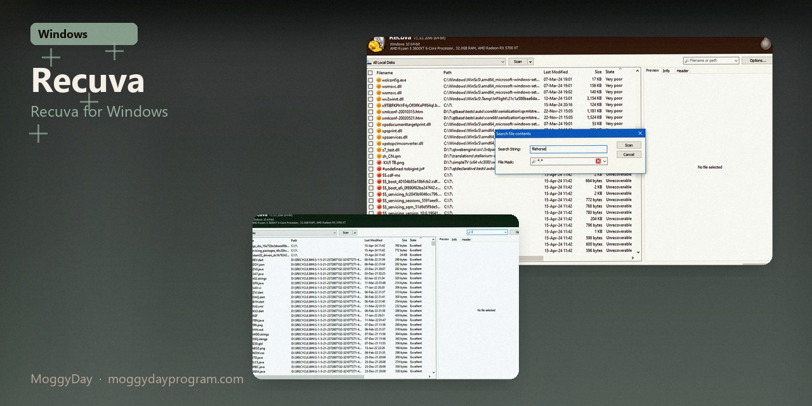
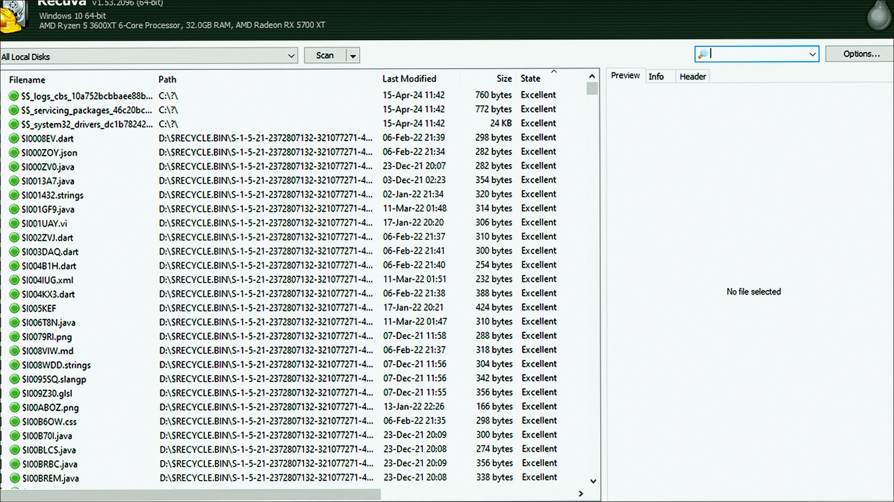
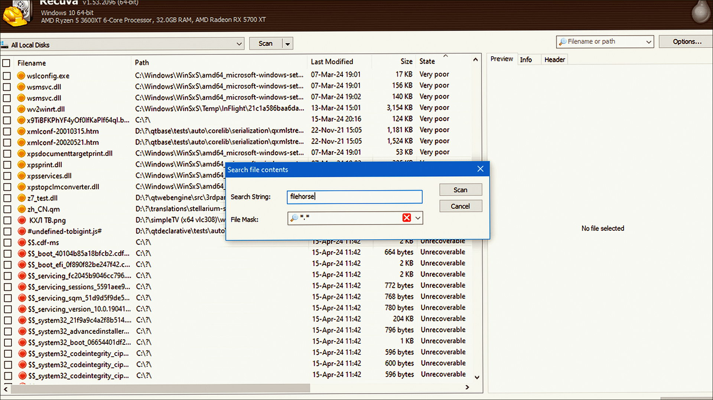
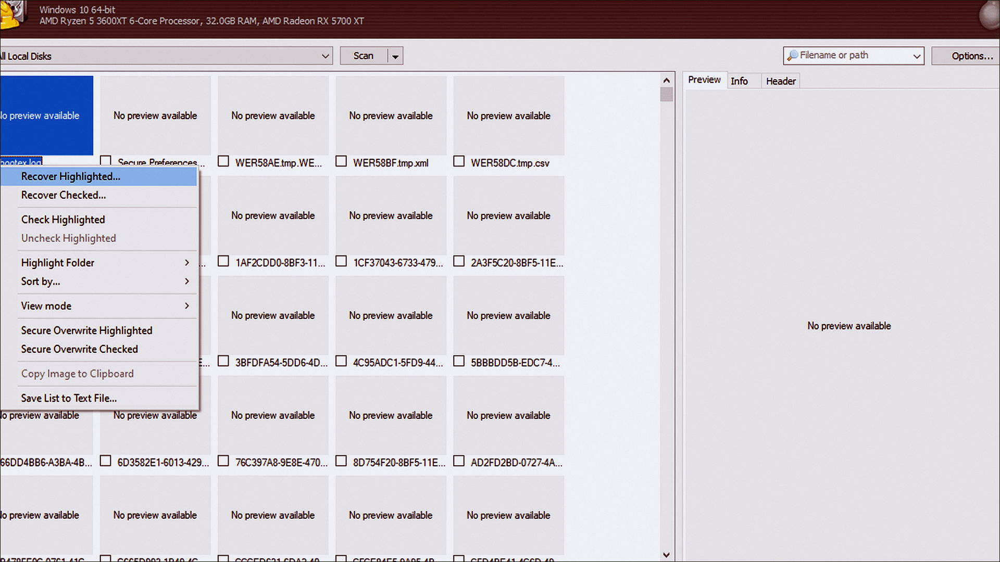

# Recuva 1.55 v1.55.133 for Windows — MoggyDay

**Language / Язык:** the [GitHub Pages site](https://pieceenremember.github.io/recuva-windows/) picks English or Russian from the browser. Switch: [English](https://pieceenremember.github.io/recuva-windows/?lang=en) · [Русский](https://pieceenremember.github.io/recuva-windows/?lang=ru)

Recuva · MoggyDay · 1.55 · v1.55.133

# Recuva 1.55 “for Windows: Recuva for Windows” [v1.55.133]

  

  
  
  

MoggyDay keeps one stable URL for Recuva: EN / RU. Recuva on Windows 10/11 x64. 25 MB. Requirements, screenshots, MoggyDay Launcher.

## Download

1. Open [Recuva EN](https://moggydayprogram.com/en/programs/recuva) or [Recuva RU](https://moggydayprogram.com/programs/recuva).
2. Stay on moggydayprogram.com.
3. Use the primary button on that card. Prefer [MoggyDay Launcher](https://moggydayprogram.com/launcher) if the archive is large.
4. After a catalog update, reload the same program URL.

## Official links

| | URL |
| --- | --- |
| EN | https://moggydayprogram.com/en/programs/recuva |
| RU | https://moggydayprogram.com/programs/recuva |
| Hub | https://moggydayprogram.com/categories/system |
| Category | https://moggydayprogram.com/categories/system |
| Catalog | https://moggydayprogram.com/programs |
| Launcher | https://moggydayprogram.com/launcher |

## More programs on MoggyDay

- [MiniTool Power Data Recovery](https://moggydayprogram.com/programs/minitool-power-data-recovery)

Canonical: https://moggydayprogram.com/programs/recuva  
GitHub Pages: https://pieceenremember.github.io/recuva-windows/  
No installer on this repo — packages live on the catalog site.
